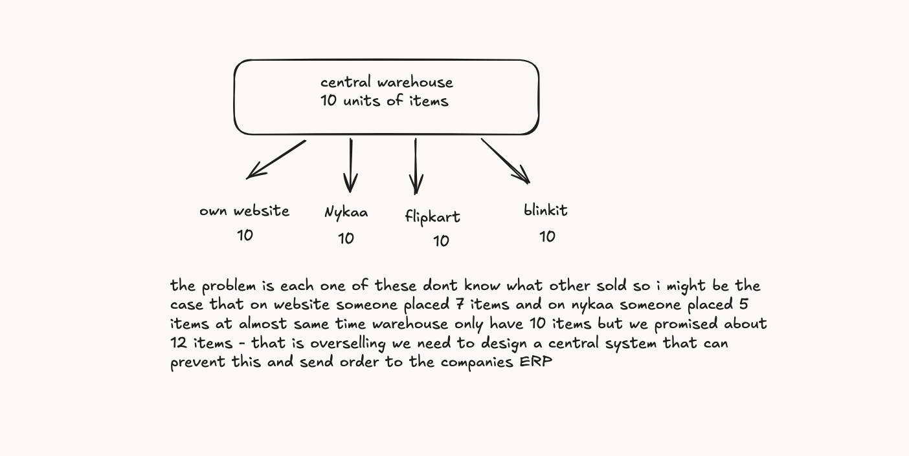
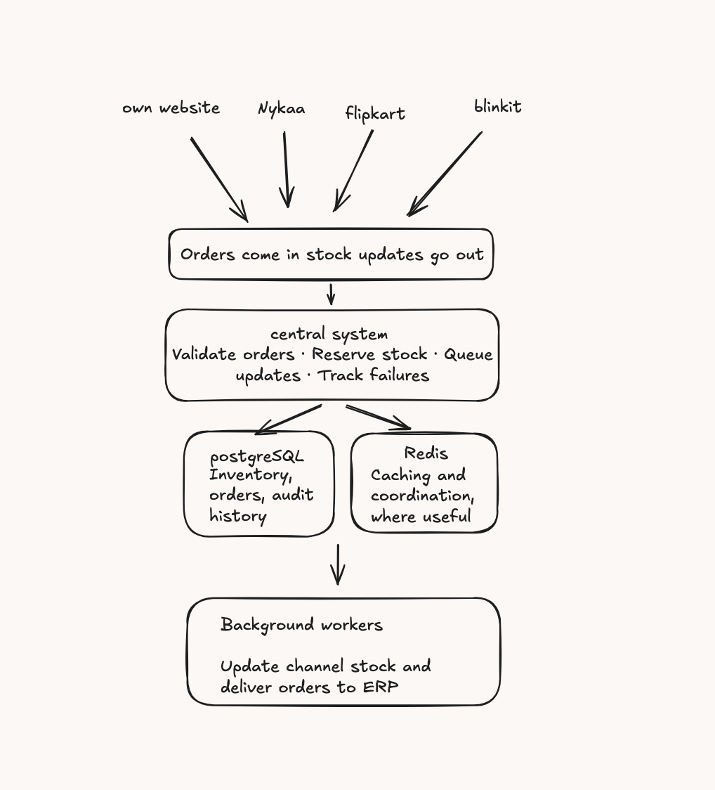

# MARS Cosmetics — Order & Inventory Sync Service

> **AI Reference:** The core idea, problem analysis, and HLD are my own. I used ChatGPT to structure my explanation and turn my HLD into this Markdown document. AI assistance was used for wording and documentation, not to originate my overall design idea.

## 1. Problem Statement

MARS Cosmetics sells approximately 1,200 SKUs across its own website, Nykaa, Flipkart, and Blinkit. All orders are fulfilled from one central warehouse, but each channel currently receives stock updates manually twice a day.

Since each channel may have outdated inventory information, multiple channels can accept orders for stock that is no longer available. This can lead to overselling, cancellations, and poor marketplace ratings.

The goal is to design a centralized Order & Inventory Sync Service that collects orders from all four channels, reserves stock, keeps channel inventory updated, and sends confirmed orders to Microsoft Business Central (ERP).

## 2. High-Level Design (HLD)

The proposed system uses one central service to coordinate order processing, inventory management, stock synchronization, and ERP delivery.

### Main components

- **Sales channels:** The website, Nykaa, Flipkart, and Blinkit generate orders and receive stock updates through their respective integration methods.
- **Central system:** Validates incoming orders, manages stock reservations, queues updates, and tracks failures.
- **PostgreSQL:** Stores orders, inventory, and audit history. It acts as the source of truth for inventory reservations.
- **Redis:** Supports caching and coordination where useful. It is not the authoritative inventory store.
- **Background workers:** Process queued stock updates and deliver confirmed orders to the ERP asynchronously.
- **Microsoft Business Central:** Receives confirmed orders and handles invoicing and dispatch.

### Order and inventory flow

1. Orders arrive from the sales channels through webhooks or polling.
2. The central system validates and normalizes each order.
3. Available stock is checked and reserved in PostgreSQL.
4. The inventory change and pending background work are recorded durably.
5. Background workers push updated quantities to the relevant sales channels.
6. Confirmed orders are delivered to Business Central.
7. Failed operations are tracked and retried.

## 3. Data Model

The following tables provide the initial data model.

| Table | Purpose |
|---|---|
| `orders` | Stores the normalized order, channel, external order ID, and order status. |
| `order_items` | Stores the SKUs, quantities, and prices associated with each order. |
| `inventory` | Stores physical stock and reserved stock for each SKU. |
| `inventory_movements` | Records stock changes and their reasons for auditing. |
| `inbound_events` | Tracks incoming events to prevent duplicate processing. |
| `outbox_jobs` | Stores pending stock-sync and ERP-delivery work. |
| `channel_sync_state` | Tracks desired stock quantities and synchronization status per channel and SKU. |
| `erp_delivery` | Tracks ERP delivery status, retry attempts, and errors for each order. |

### Important constraints

- Each order has a unique `(channel, external_order_id)` combination.
- Each SKU has one authoritative inventory record.
- Stock and reserved quantities cannot be negative.
- An order must not reserve stock more than once.
- ERP delivery records must be unique per internal order.
- Inventory movements are retained as an audit trail rather than silently overwritten.

## 4. Order Ingestion

Each channel has a different integration method, so the central system will normalize incoming orders into a common format.

- **Website:** Receives order-creation and cancellation webhooks.
- **Nykaa:** Processes webhooks while handling duplicate and out-of-order events.
- **Flipkart:** Polls for orders every two minutes, using checkpoints and deduplication.
- **Blinkit:** Receives webhooks and reconciles orders where suitable reports or lookup APIs are available.

Incoming events are validated and deduplicated before business processing. Repeated events must not create duplicate orders or reserve stock twice.

If a channel is temporarily unavailable, its integration can recover through retries and reconciliation without stopping order processing for the other channels.

## 5. Inventory Consistency

The most important problem is preventing two channels from selling the same last unit.

For example, suppose the warehouse has 10 units and 9 units are already reserved. The available stock is one unit.

If the website and Nykaa both receive an order for that final unit at almost the same time, a simple read-then-update approach could allow both orders to proceed.

To prevent this, PostgreSQL will perform an atomic conditional inventory update inside a transaction. The reservation succeeds only if enough available stock remains.

The transaction will also record the reservation and required background work. If any item in a multi-item order cannot be reserved, the reservation transaction will roll back.

The first transaction reserves the final unit; the second transaction finds insufficient stock and cannot reserve it.

**Limitation:** This protects the central inventory database. It cannot instantly prevent every marketplace from accepting an order using stale stock information, particularly when Flipkart polling is delayed. Conservative stock allocations, timely stock pushes, and reconciliation help reduce this risk.

## 6. Stock Synchronization

Background workers will update channel inventory asynchronously, respecting each channel's limitations.

| Channel | Synchronization approach |
|---|---|
| Website | Update through the owned API or database integration. |
| Nykaa | Send one SKU per request, respecting the five-requests-per-second limit. |
| Flipkart | Batch up to 50 SKUs per request and respect rate limits and HTTP 429 responses. |
| Blinkit | Use the daily CSV upload and REST API for urgent updates. |

The system will track desired quantities and the last successfully synchronized quantities. Obsolete queued updates can be coalesced so workers send the latest desired stock level.

The target is to update channel stock within 60 seconds under normal load. Provider outages, rate limits, and delayed polling can prevent this target from being met in every situation, so synchronization latency must be monitored.

## 7. Failure Handling

### ERP downtime

ERP delivery jobs will be stored durably and retried after Business Central becomes available. Orders received during its downtime must remain available for delivery.

### Blinkit timeouts

A timeout does not necessarily mean an update failed; the provider might have processed it without returning a response. The system should reconcile the outcome before retrying when possible.

### Rate limits and temporary failures

Workers will use bounded retries with exponential backoff and jitter, respecting `Retry-After` when supplied.

### Repeated failures

Jobs that repeatedly fail will be marked for manual investigation. The operations team can inspect the error and retry the existing job without creating another order or reservation.

### Duplicate ERP delivery

A stable order reference and idempotent ERP operation, where supported, will prevent duplicate order creation. If the ERP's result is ambiguous after a timeout, the system must reconcile before retrying.

Exactly-once ERP creation depends on Business Central supporting idempotency or a reliable lookup-and-reconciliation mechanism. This capability must be verified during implementation.

## 8. Observability

The following metrics and alerts will help the team detect problems early:

1. **Order ingestion lag:** Age of the oldest unprocessed order event.
2. **Stock synchronization latency:** Time taken to reflect a stock change on a channel.
3. **Reservation failures:** Failed reservations and stock-related order cancellations.
4. **ERP backlog:** Pending orders and age of the oldest ERP delivery job.
5. **Integration failures:** API timeouts, HTTP 429 responses, retry counts, and growing queues.

The operations dashboard will show failed syncs, error details, retry status, and inventory-change history.

## 9. Scope

### Included in v1

- Integrations with all four sales channels.
- Centralized order ingestion and deduplication.
- Atomic stock reservations.
- Cancellation and return processing.
- Asynchronous stock synchronization.
- Durable ERP delivery and retries.
- Audit history and a basic operations dashboard.

### Excluded from v1

- Multi-warehouse inventory allocation.
- Advanced demand forecasting.
- An LLM-based investigation assistant.
- A complex distributed event-streaming platform unless actual throughput requires it.

These features can be considered later to keep the first version achievable for a three-developer team within six weeks.

## 10. Assumptions

- All channels use stable SKU mappings to the central inventory.
- The APIs behave according to the limits specified in the assignment.
- Webhook authentication and payload details will be confirmed during implementation.
- A returned item is restocked only after it is confirmed suitable for resale.
- Business Central's idempotency and order-lookup capabilities will be verified before implementation.
- The 60-second stock synchronization target applies under normal operating conditions.

## 11. Trade-offs

| Decision | Chosen approach | Alternative rejected | Reason |
|---|---|---|---|
| Inventory consistency | PostgreSQL transactions and conditional updates | Redis as the source of truth | Keeps stock reservations durable and transactional. |
| Processing model | Background workers and durable jobs | Synchronous calls to every channel | Prevents one slow integration from blocking the entire flow. |
| Database | One central PostgreSQL database | Separate inventory databases per channel | Maintains a single authoritative inventory record. |
| Deployment | Small AWS deployment with managed PostgreSQL and limited supporting services | A large microservices platform | Reduces operational complexity and helps control cost. |

## 12. Implementation Priorities

1. Build normalized order ingestion and deduplication.
2. Implement and test atomic inventory reservations.
3. Add durable jobs, stock synchronization, and ERP delivery.
4. Add retries, reconciliation, monitoring, and the operations dashboard.
5. Validate sale-day throughput, concurrency, and recovery from failures.

The design prioritizes inventory correctness, durable order processing, and operational simplicity while leaving room for future growth.